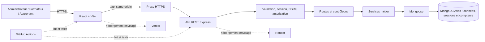
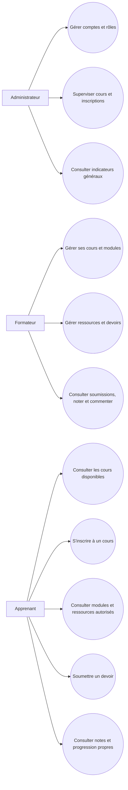
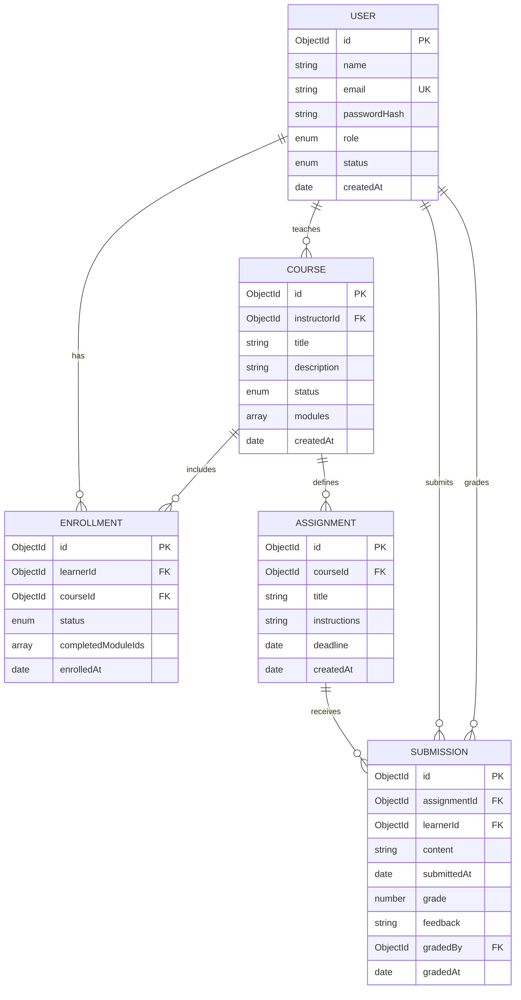

# Conception v1 — architecture, données et API

**Statut :** première conception de travail, après validation de la synthèse des besoins par l'encadrant selon confirmation de l'étudiant le 2026-10-19. À revoir avant implémentation lorsque les décisions ouvertes de cette note seront tranchées.

## 1. Principes d'architecture

- Interface React/Vite, API REST Node/Express et MongoDB Atlas avec Mongoose.
- Séparation entre présentation, routes, contrôleurs, services métier, modèles, middleware et configuration.
- Le serveur valide les entrées et applique les règles de rôle, d'inscription et de propriété sur chaque opération protégée.
- Le frontend ne constitue pas une frontière de sécurité : masquer une action dans l'interface ne remplace pas le contrôle API.
- Les réponses ne renvoient que les champs nécessaires ; les journaux ne contiennent ni mot de passe, ni jeton, ni contenu de soumission privé.
- Hébergement prévu : Vercel (frontend), Render (API), Atlas (base), GitHub Actions (CI), sous réserve de vérifier les offres et quotas.
- En production, le frontend doit exposer l'API sous la même origine via un proxy `/api` ; ne pas dépendre d'un cookie tiers entre domaines d'hébergement.

## 2. Diagramme d'architecture logique

La décision D-02 est prise : les sessions sont conservées côté serveur dans MongoDB via `connect-mongo`. Le cookie de session est HttpOnly, SameSite=Lax, limité à la racine et, en production, Secure avec le préfixe `__Host-` sans attribut Domain. La durée absolue est limitée à huit heures ; l'identifiant est renouvelé après connexion, inscription et changement de mot de passe. Un compteur de version sur le compte révoque les anciennes sessions après changement de mot de passe. Les mutations API exigent un jeton CSRF synchronisé dans `X-CSRF-Token`, contrôlé en temps constant ; SameSite et la vérification d'origine servent de défense supplémentaire. Les mots de passe sont hachés en Argon2id (m=19 456 KiB, t=2, p=1). Les limites par adresse IP sont : dix connexions échouées par quinze minutes, vingt inscriptions par heure, cinq tentatives de changement de mot de passe par quinze minutes, soixante créations de session CSRF par quinze minutes, trente écritures de cours par quinze minutes, vingt inscriptions à un cours par heure, vingt écritures de comptes par heure et soixante lectures/recherches de comptes par quinze minutes. Les compteurs de production sont partagés via MongoDB et l'adresse IP est stockée sous forme de HMAC.

La MFA est limitée à cinq essais par compte administrateur sur quinze minutes, avec un identifiant HMACé en base ; les remises et corrections sont limitées à trente écritures par adresse IP et par heure, et les tableaux de bord à soixante lectures par quinze minutes. Les changements de rôle, d'état et de mot de passe révoquent les sessions antérieures par incrément de `sessionVersion`.

La décision D-12 est prise : le catalogue public ne présente que les métadonnées des cours publiés. Le contenu des modules est accessible au propriétaire formateur et à l'administrateur ; l'apprenant doit être inscrit à un cours publié. Une inscription est unique par couple apprenant-cours en base de données. La suppression d'un cours est un archivage afin de garder les références d'inscription. Les ressources du premier périmètre sont du texte ou des liens HTTPS.

Les décisions D-05 à D-07 et D-13 définissent le MVP des évaluations : les remises sont du texte sans fichier joint, une seule remise active est conservée et peut être remplacée avant l'échéance si elle n'a pas encore été notée ; les remises tardives sont refusées et une remise notée est verrouillée. Le formateur propriétaire et l'administrateur peuvent corriger et commenter. Les valeurs de note sont bornées par le maximum du devoir. La progression est déclarative : l'apprenant marque lui-même les modules terminés ; le tableau de bord divise les modules terminés par le nombre de modules des cours publiés suivis.

La MFA administrateur utilise TOTP : le secret est chiffré en AES-256-GCM avec `MFA_ENCRYPTION_KEY`, clé distincte de la clé de session ; les étapes déjà utilisées sont refusées, et dix codes de secours aléatoires ne sont montrés qu'une fois et ne sont conservés qu'en HMAC. Les vérifications MFA sont limitées. Une session administrateur ne reçoit aucun accès privilégié tant que l'enrôlement ou le défi MFA n'est pas terminé. La production exige une clé de chiffrement stable, conservée dans le gestionnaire de secrets.

La production doit servir l'interface et l'API sous la même origine à travers un proxy HTTPS. CORS reste restreint à `CLIENT_ORIGINS`, avec identifiants activés ; l'API exige des origines HTTPS publiques et une URI MongoDB qui utilise TLS. `TRUST_PROXY_HOPS` doit correspondre au nombre exact de proxies de confiance, jamais être configuré sans connaître l'ingress.

Références de sécurité : recommandations OWASP sur la [gestion des sessions](https://cheatsheetseries.owasp.org/cheatsheets/Session_Management_Cheat_Sheet.html), la [prévention CSRF](https://cheatsheetseries.owasp.org/cheatsheets/Cross-Site_Request_Forgery_Prevention_Cheat_Sheet.html) et le [stockage des mots de passe](https://cheatsheetseries.owasp.org/cheatsheets/Password_Storage_Cheat_Sheet.html). `connect-mongo` documente la compatibilité de sa version actuelle avec Node.js 24 dans son [dépôt officiel](https://github.com/jdesboeufs/connect-mongo).

## 3. Cas d'utilisation principaux

## 4. Modèle de données prévisionnel

### Justification et intégrité initiales

- `User` porte un rôle (`admin`, `instructor`, `learner`) et un statut d'activation. `passwordHash` ne contient jamais le mot de passe en clair.
- `User.mustChangePassword` impose le remplacement d'un secret temporaire avant l'accès aux routes métier ; `sessionVersion` révoque les sessions après changement ou réinitialisation du mot de passe.
- `Course` référence son formateur propriétaire. Les modules et petites ressources (URL, titre, ordre, métadonnées) sont prévus comme sous-documents pour les lire avec leur cours ; réévaluer si volume ou règles de gestion l'exigent.
- `Enrollment` matérialise l'inscription et son état. L'index unique composé `(learnerId, courseId)` empêche les doublons, y compris sous concurrence.
- `Assignment` est séparé, car ses listes et échéances sont consultées indépendamment des cours.
- `Submission` référence le devoir et l'apprenant ; le texte est limité à 20 000 caractères. Le couple `(assignmentId, learnerId)` est unique. Correcteur et date de correction permettent de tracer la notation.
- `Enrollment.completedModuleIds` conserve les modules déclarés terminés. Le pourcentage est calculé à la lecture et n'est pas enregistré.
- Index proposés : `User.email` unique normalisé ; `Course(status, createdAt)` et `Course(instructorId)` ; `Enrollment(learnerId, courseId)` unique et `Enrollment(courseId, status)` ; `Assignment(courseId, deadline)` ; `Submission(assignmentId, learnerId)` et `Submission(learnerId, submittedAt)`.
- Les références MongoDB ne garantissent pas l'intégrité relationnelle ; les services vérifient existence, statut d'inscription et autorisations.

### Politique de fichiers

Seules les métadonnées et références de stockage iront dans MongoDB. Le service de stockage, les types autorisés, la taille maximale, la durée de conservation et l'analyse des fichiers restent à décider avant le module de soumission.

## 5. Matrice d'autorisations initiale

| Ressource / opération | Anonyme | Apprenant | Formateur propriétaire | Administrateur |
|---|---|---|---|---|
| Métadonnées des cours publiés | Lire | Lire | Lire | Lire |
| Cours brouillons | Non | Non | Lire/modifier ses cours | Superviser |
| Modules et ressources | Non | Lire si inscrit à un cours publié | Gérer ses cours | Superviser |
| Inscriptions | Non | Créer la sienne à un cours publié ; voir les siennes | Voir les inscrits de ses cours | Superviser |
| Devoirs | Non | Lire ceux des cours suivis | Créer/gérer ceux de ses cours | Superviser |
| Soumissions | Non | Créer/lire sa remise | Lire les remises de ses cours, noter/commenter | Superviser selon nécessité |
| Comptes et rôles | Inscription apprenant seulement | Gérer profil propre (champs limités) | Gérer profil propre | Gérer comptes et rôles |
| Indicateurs | Non | Progression propre | Résultats de ses cours | Indicateurs généraux agrégés |

Chaque règle doit donner lieu à des tests positifs et négatifs. Les droits exacts d'administration sur les données pédagogiques doivent respecter le principe du moindre privilège.

## 6. Première spécification REST

Préfixe proposé : `/api/v1`. JSON sur HTTPS ; format d'envoi de fichier à décider avec le stockage. Codes usuels : `200`, `201`, `204`, `400`, `401`, `403`, `404`, `409`, `422`, `429`, `500`. Les erreurs utilisent un format uniforme sans détail sensible. Pagination proposée par `page` et `limit` borné, avec `items` et `pagination`.

| Méthode et chemin | Usage | Accès / contrôle essentiel |
|---|---|---|
| `POST /auth/register` | Inscription apprenant | Public ; serveur fixe `role=learner`, ignore/refuse le rôle fourni. |
| `POST /auth/login` | Connexion | Public ; limitation de débit et erreur générique. |
| `POST /auth/logout` | Déconnexion | Authentifié ; invalide la session selon D-02. |
| `GET /auth/me` | Identité courante | Authentifié ; jamais de hash ou secret. |
| `GET /users` | Liste de comptes | Admin ; pagination et recherche limitée aux noms/courriels. |
| `POST /users/instructors` | Créer un formateur | Admin seulement ; secret temporaire aléatoire renvoyé une fois, changement obligatoire au premier accès. |
| `POST /users/{id}/reset-password` | Réinitialiser un mot de passe | Admin seulement ; révoque les sessions et impose un nouveau changement ; mot de passe renvoyé une fois. |
| `POST /users/{id}/reset-mfa` | Réinitialiser la MFA d'un admin | Un autre admin actif ; invalide les sessions et force le nouvel enrôlement ; journalise acteur et cible sans secret. |
| `PATCH /users/{id}` | Modifier rôle/état | Admin seulement ; promotion admin possible, mais un compte admin ne peut être rétrogradé/désactivé ; un formateur propriétaire de cours non archivés ne peut perdre son accès. |
| `POST /auth/change-password` | Changer son mot de passe | Session authentifiée et CSRF ; vérifie le mot de passe courant, renouvelle la session et invalide les sessions précédentes. |
| `GET /auth/mfa/setup` | Préparer l'enrôlement admin | Admin non enrôlé ; secret TOTP et URI d'installation sans cache. |
| `POST /auth/mfa/enable` | Confirmer l'enrôlement | Admin avec code TOTP valide ; codes de secours renvoyés une fois. |
| `POST /auth/mfa/verify` | Confirmer une connexion admin | Défi de session ; TOTP anti-rejeu ou code de secours à usage unique. |
| `GET /courses` | Catalogue publié | Public ; métadonnées seulement, pagination. |
| `GET /courses/mine` | Cours gérés | Formateur : ses cours ; admin : supervision ; pagination. |
| `POST /courses` | Créer un cours brouillon | Formateur ; propriétaire fixé par l'identité courante. |
| `GET /courses/{id}` | Métadonnées du cours | Seulement si publié ; aucune donnée de module. |
| `GET /courses/{id}/content` | Modules et ressources | Formateur propriétaire ou admin ; apprenant inscrit à un cours publié. |
| `PATCH /courses/{id}` | Modifier cours / publier | Formateur propriétaire ou admin ; publication exige au moins un module. |
| `DELETE /courses/{id}` | Archiver cours | Formateur propriétaire ou admin ; pas de suppression physique. |
| `POST /courses/{id}/enrollments` | S'inscrire | Apprenant courant et cours publié ; doublon → `409` (index unique). |
| `GET /courses/{id}/enrollments` | Lister inscrits | Formateur propriétaire ou admin ; pagination, identité minimale. |
| `GET /enrollments/me` | Mes inscriptions | Apprenant courant uniquement ; pagination. |
| `PUT /courses/{id}/modules/{moduleId}/completion` | Marquer un module terminé/non terminé | Apprenant inscrit au cours publié ; état propre à l'inscription. |
| `POST /courses/{id}/assignments` | Créer devoir | Formateur propriétaire ; validation de l'échéance et des champs. |
| `GET /courses/{id}/assignments` | Lister devoirs | Inscrit actif, formateur propriétaire ou admin. |
| `POST /assignments/{id}/submissions/me` | Remettre/modifier un travail | Apprenant inscrit ; texte uniquement, avant échéance et avant notation. |
| `GET /assignments/{id}/submissions/me` | Lire sa remise/son retour | Apprenant courant uniquement. |
| `GET /assignments/{id}/submissions` | Voir remises | Formateur propriétaire ou admin ; pagination. |
| `PATCH /submissions/{id}/grade` | Noter/commenter | Formateur propriétaire ; trace correcteur et date. |
| `GET /dashboard` | Résumé par rôle | Authentifié ; filtrage strict selon identité et rôle. |

Cette liste est un contrat de travail, pas encore la spécification OpenAPI finale. Chaque route devra préciser schéma, réponse, erreurs, validation et tests d'autorisation.

Les routes d'authentification sous `/api/v1/auth` incluent `GET /csrf`, `POST /register`, `POST /login`, `POST /change-password`, `POST /logout`, `GET /me` et le parcours MFA. Les réponses de compte n'incluent jamais les hashes de mot de passe, secrets TOTP ou hashes de codes de secours. La commande `npm run provision:admin --workspace @educloud/api` crée le premier administrateur à partir de variables d'environnement opérées côté serveur ; elle refuse l'opération si un administrateur existe déjà. L'API ne crée jamais de compte formateur par inscription publique ; seul un administrateur connecté peut le faire.

## 7. Risques de conception

| Risque | Mesure de réduction |
|---|---|
| Contrôle d'accès oublié sur une route ou relation | Vérification rôle/propriété dans les services ; tests négatifs par rôle et identifiant. |
| Inscriptions doublonnées sous concurrence | Index unique composé ; erreur duplicate-key traduite en `409`. |
| Fichier malveillant ou volumineux | Stockage séparé, limites de taille/type, accès restreint, contrôle à préciser. |
| Secret ou donnée personnelle dans dépôt/logs | Variables d'environnement, `.env` ignoré, revue des logs, données synthétiques hors production. |
| Compromission d'un compte privilégié | Provisionnement contrôlé, limitation des connexions et ajout d'une MFA administrateur avant mise en production (D-11). |
| Progression trompeuse | Règle explicite, explicable et testée ; dérivée des modules terminés. |
| Limites/coûts cloud | Vérifier quotas, veille, sauvegardes, région et facturation avant mise en ligne. |

## 8. Décisions à lever avant l'implémentation concernée

- D-05 : les téléversements sont reportés jusqu'à la décision d'un stockage objet privé.
- D-06, D-07 et D-13 : règles MVP consignées dans le registre des décisions ; revue métier à faire avant production.
- Suppression/archivage des comptes avec données liées.

Voir le [registre des décisions](../decisions/decisions-ouvertes.md). Aucun point qui change les règles métier ne doit être figé silencieusement dans le code.
